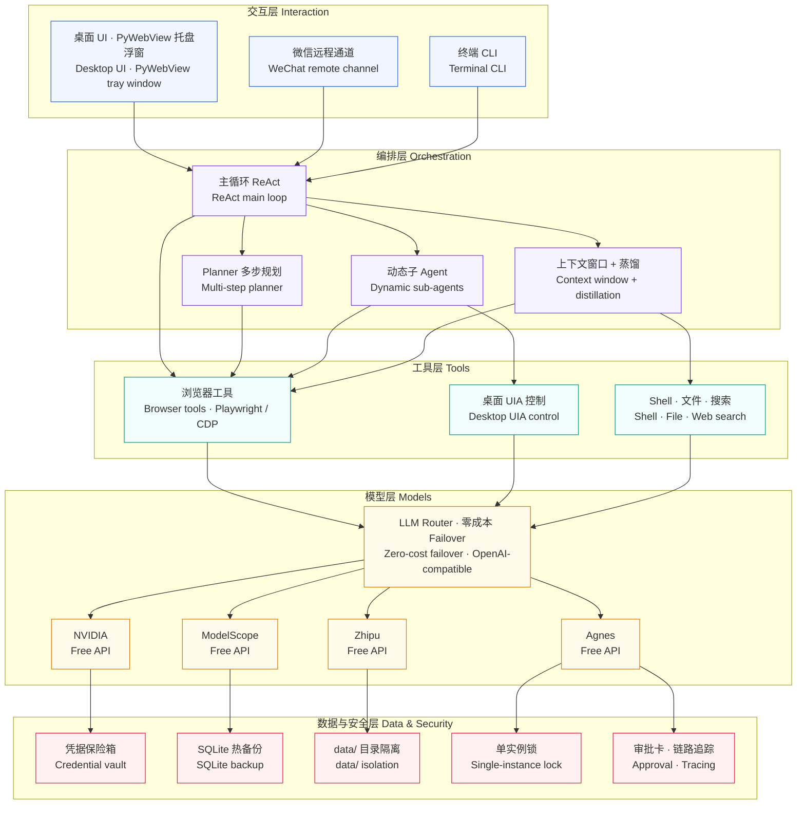
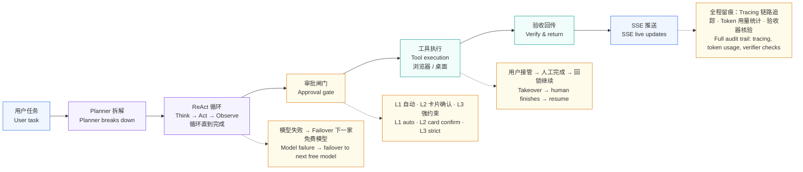
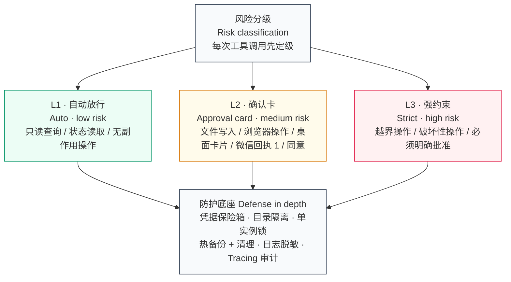
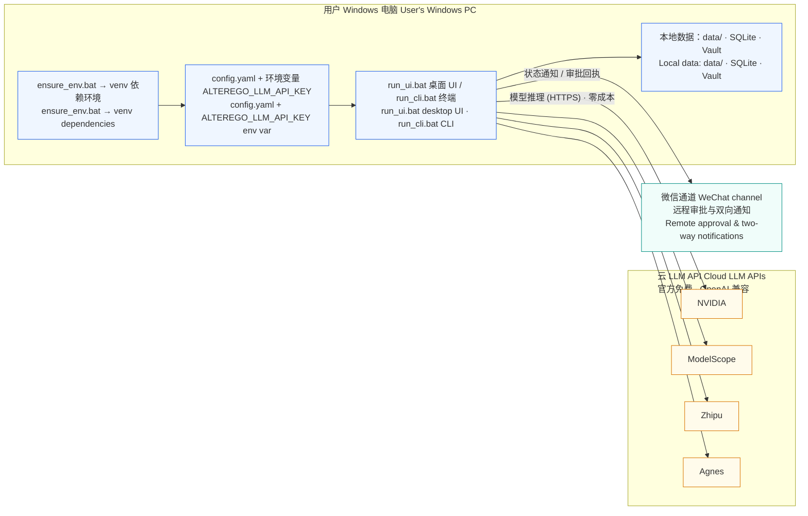

# OpenMuse-Win (AlterEgo)

Windows 原生单机个人 AI Agent。0→1 自研编排层，不基于 LangChain / AutoGen / CrewAI 等整套框架。

[](https://doi.org/10.5281/zenodo.23446166)
[](LICENSE)

> **论文正式发布**：
> 《**AlterEgo: Towards the Zero-Cost Personal Agent**》  
> - **DOI**: [10.5281/zenodo.23446166](https://doi.org/10.5281/zenodo.23446166)  
> - **Zenodo 页面**: [https://zenodo.org/records/23446166](https://zenodo.org/records/23446166)  
> - **公开开源仓库**: [https://github.com/wojiadexiaoming-copy/openmuse-win](https://github.com/wojiadexiaoming-copy/openmuse-win)
> 
> 🏆 **BoHack 2026 评审核验指引（42小时冲刺成果）**：  
> 本项目带 1.0 开源基线 (`openmuse-win`) 参赛。在活动期间 **42 小时冲刺** 内，累计完成 **+273 个新增文件**、**+41,869 行新增代码**，重点攻坚多进程硬隔离、复杂 SPA 浏览器原生事件链、微信移动端双向审批与全新桌面高保真工作台重构。  
> - 📄 完整对照报告：[**《🏆 BoHack 2026 42小时技术增量与基线对照报告》**](docs/🏆%20BoHack%202026%2042小时技术增量与基线对照报告.md) / [ASCII 镜像](docs/BoHack_2026_42h_Increment_Report.md)  
> - 📝 详细更新日志：[**CHANGELOG.md**](CHANGELOG.md)  
> - 🌿 对应发布分支：[`v1.1-20261114`](https://github.com/wojiadexiaoming-copy/openmuse-win/tree/v1.1-20261114)

> 许可状态：AGPL-3.0 + 商业许可（双许可），**最终条款待律师审核**，见 `LICENSE_STATUS.md`。

## 真实评测 | Real-World Evaluation

2026-10-29 实拍，三段任务连续完成，均含步骤字幕。
Recorded on Oct 29, 2026: three tasks completed in one continuous session, with step subtitles burned in.

<table>
  <tr>
    <td align="center" width="33%">
      <video controls width="100%" src="https://alterego.inodetree.com/AlterEgo-demo-1-trip.mp4"></video><br/>
      <b>1. 规划北京到美国 7 天旅行 | 7-Day Beijing–US Trip Planning</b>（1:55）<br/>
      查机票、比价、选日期 · Flights, prices, dates<br/>
      <a href="https://alterego.inodetree.com/AlterEgo-demo-1-trip.mp4">直接看 | Direct link</a>
    </td>
    <td align="center" width="33%">
      <video controls width="100%" src="https://alterego.inodetree.com/AlterEgo-demo-2-poster.mp4"></video><br/>
      <b>2. 豆包生成 2027 元旦海报 | 2027 New Year Poster via Doubao</b>（0:45）<br/>
      红金配色、立体数字 · Red-gold, 3D numerals<br/>
      <a href="https://alterego.inodetree.com/AlterEgo-demo-2-poster.mp4">直接看 | Direct link</a>
    </td>
    <td align="center" width="33%">
      <video controls width="100%" src="https://alterego.inodetree.com/AlterEgo-demo-3-desktop.mp4"></video><br/>
      <b>3. 桌面文件夹与 Markdown 文档 | Desktop Folder &amp; Markdown File</b>（1:39）<br/>
      新建文件夹、写文档、L2 审批 · Folder, doc, L2 approval<br/>
      <a href="https://alterego.inodetree.com/AlterEgo-demo-3-desktop.mp4">直接看 | Direct link</a>
    </td>
  </tr>
</table>

## 当前系统能力与里程碑

按 `docs/spec.md` 与 `docs/完善路线图.md` 推进，核心里程碑已全线贯通：

- **编排与治理**：ReAct 反应式主循环、Planner 多步规划与动态子 Agent、上下文滑动窗口与 Worker 异步会话蒸馏。
- **安全与权限**：三级审批卡片机制（L1 自动/L2 确认/L3 强约束）、Windows 凭据保险箱（Vault for Machine）、工作目录越界隔离。
- **桌面与多通道**：Windows 原生 UIA 桌面控制、PyWebView 托盘浮窗、WeChat 远程审批与双向通知通道。
- **数据生命周期**：统一 `data/` 目录隔离、多进程单实例互斥锁（SingleInstanceLock）、SQLite 在线热备份与保留期自动清理（Retention）。
- **观测与度量**：全链路 Tracing、Token 用量实时统计、Server-Sent Events (SSE) 全量状态广播。

## 系统架构 | System Architecture

AlterEgo 的核心设计只有一句话：大脑在云端免费模型，执行永远在用户本机。
One sentence sums up the design: the brain runs on free cloud models, execution always stays on the user's machine.

### 总体架构 | System Overview



五层结构：交互层接用户，编排层做规划与执行，工具层操作浏览器与桌面，模型层走四家官方免费 API 做零成本 failover，数据与安全层兜底。
Five layers: interaction takes user input, orchestration plans and executes, tools drive the browser and desktop, the model layer fails over across four official free APIs at zero cost, and the data & security layer holds everything together.

### 任务执行流水线 | Task Execution Pipeline



一句话任务进来后，Planner 拆解、ReAct 循环执行、审批闸门按风险定级放行、工具执行、验收回传，全程经 SSE 实时推送。
A one-sentence task goes through Planner breakdown, ReAct execution, risk-tiered approval gating, tool execution, and verified return, streaming over SSE all the way.

### 安全与审批架构 | Security & Approval



每一次工具调用先按风险定级：L1 自动放行、L2 卡片确认、L3 强约束；底座是凭据保险箱、目录隔离、单实例锁、热备份与日志脱敏。
Every tool call is risk-classified first: L1 auto, L2 card confirmation, L3 strict; the base is the credential vault, directory isolation, single-instance lock, backups, and log scrubbing.

### 部署拓扑 | Deployment



部署就是一台 Windows 电脑：ensure_env.bat 建环境、config.yaml + 环境变量配 key、run_ui.bat / run_cli.bat 启动；云端只出模型推理，微信通道只做远程审批与通知。
Deployment is one Windows PC: ensure_env.bat sets up the environment, config.yaml plus an env var holds the key, run_ui.bat / run_cli.bat start it; the cloud only does inference, WeChat only does remote approval and notifications.

## 🚀 版本历史 | Changelog

当前版本 v1.5.31：微信审批回执、授权降噪与前端可见。
Current version v1.5.31: WeChat approval receipts, authorization noise reduction, frontend visibility.

完整版本迭代历史见 [CHANGELOG.md](CHANGELOG.md)。
Full version history: [CHANGELOG.md](CHANGELOG.md).

## 快速开始（Windows）

> 宿主机 + Hyper-V 虚拟机共享同一目录开发时：venv 必须每台机器各建一份。
> 直接运行 `ensure_env.bat`（自动识别/创建/装依赖），再 `run_ui.bat` / `run_cli.bat`。
> 不要复制另一台机器的 `.venv*`、`vault-*`。完整规则见 `docs/双机开发环境.md`。

```powershell
# 1. 准备本机环境（幂等；requirements.txt 变化时自动补装）
ensure_env.bat

# 2. 配 config
copy config.example.yaml config.yaml
# 填 llm.base_url / llm.model，API Key 走环境变量 ALTEREGO_LLM_API_KEY
# （M2 才接 Vault，M1 用环境变量，见 config.example.yaml）

# 3. 跑
run_ui.bat            # 桌面 UI 壳
run_cli.bat           # 终端 CLI（等效 python -m agent.main）
```

## 仓库结构

```
agent/        编排核心（models/llm/registry/context/orchestrator/main）
tools/        工具实现（base + shell/file/web_search）
prompts/      系统提示词（§6）
ui/           桌面 UI（H5 原型 + pywebview 壳，待真机验证）
tests/        测试（pytest）
docs/         技术规格书全文（spec.md，唯一需求来源）
PROGRESS.md   进度与待办清单（给 Antigravity 看）
CHANGELOG.md  版本迭代历史（原 README 内嵌章节）
```

